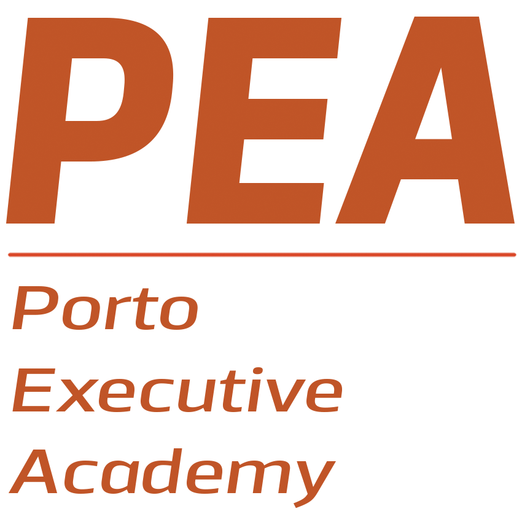
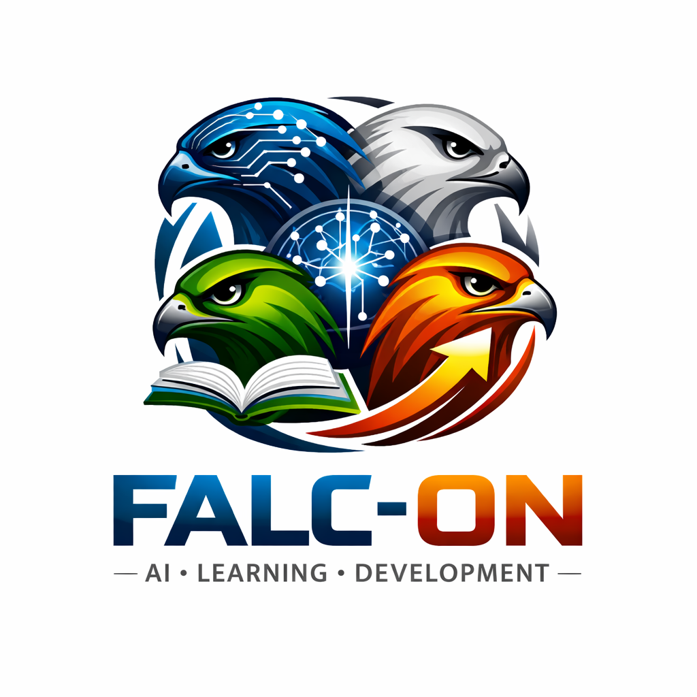

  
  &nbsp;&nbsp;&nbsp;&nbsp;
  

# 🐍 Python Foundations for AI — 2026

**Porto Executive Academy × FALC-ON** · Instructors: **Alexandra Oliveira** and **Catarina Santos**

Welcome! This repository holds the materials for the course. **New content is added here as the classes go:** each class's notebook and exercises are uploaded for that class, and the **exercise solutions are uploaded at the end of each class** — try the exercises first!

---

## 📖 About the Course

Python is the language behind modern AI. This course takes you from **no programming experience at all** to building your own small AI application: one that reads data, calls a real AI model (Google Gemini), stores the results and measures how good the AI is.

- **For:** professionals in any area — no programming experience needed.
- **Format:** 10 classes of 3 hours. Each class starts with a short explanation (up to about 45 minutes), followed by hands-on exercises.
- **Tools:** everything runs in **Google Colab**, in the browser. Nothing to install — you only need a Google account.
- **One story through the course:** *FALC-ON AI*, a course assistant that starts as a few `if` rules in Class 1 and grows, class by class, into an assistant with a memory and a real AI model.
- **A final project built one piece per class:** each exercises notebook ends with *this week's piece* of the project.

---

## 🗓️ Programme

The course starts on **Saturday, 17 October 2026**, with classes every **Saturday and Tuesday**.

| Class | Date | Topic | What you learn |
|:-----:|------|-------|----------------|
| 1 | Sat, 17 Oct | **Python as the Foundational Language of AI** | Google Colab, `print()`, variables and data types, operators, f-strings, decisions (`if`) and loops (`for`, `while`) |
| 2 | Tue, 20 Oct | **Data Structures for AI Systems** | Lists, sets and dictionaries, built-in functions and methods, JSON — and a conversation stored the way AI models read it |
| 3 | Sat, 24 Oct | **Data Analysis & Feature Preparation** | pandas: loading a CSV file, filtering, cleaning messy data, removing personal data, summarising and saving |
| 4 | Tue, 27 Oct | **Functions as AI Pipelines** | Writing your own functions: parameters, return values, default arguments, docstrings |
| 5 | Sat, 31 Oct | **Comprehensions & Functional Thinking** | Comprehensions, sorting with `lambda`, `map`, `filter`, `zip`, `any`, `all` |
| 6 | Tue, 3 Nov | **Data Visualization for AI Insights** | matplotlib and seaborn: line, bar, histogram, scatter and box plots, and a dashboard |
| 7 | Sat, 7 Nov | **Databases & Data Pipelines** | SQLite: creating tables, adding, reading, changing and deleting data with SQL; pandas and SQL together |
| 8 | Tue, 10 Nov | **Object-Oriented Python for AI Systems** | Classes and objects, attributes and methods, encapsulation, inheritance |
| 9 | Sat, 14 Nov | **AI Libraries & APIs** | Libraries and your own modules, web APIs, and calling Google Gemini with your API key kept safe |
| 10 | Tue, 17 Nov | **Final Project: AI Support Desk** | Putting it all together — plus a glimpse of what comes next: Git & GitHub, and Streamlit, with a live demo |

---

## 🎓 Evaluation

There are **two certificates**:

| Certificate | How to get it |
|-------------|---------------|
| 🎓 **Certificate of Attendance** | Attend **at least 75%** of the classes |
| 🎓 **Certificate with Grade** | Submit the **final project** on **Moodle** by **Saturday, 21 November 2026** — it is graded |

### The final project — AI Support Desk 🎧🤖

A program that helps a support team with its tickets: it loads and cleans the tickets, stores them in a database, uses **Gemini** to classify each ticket and draft a reply, measures how good the AI is, and explains the results in charts and text — your notebook is written like a report.

The full brief, with the requirements and the grading rubric, is in the [`final_project`](final_project) folder. You build the project one piece per class, so it is ready by the end of the course.

> 📤 **Submit your project on Moodle by Saturday, 21 November 2026.**

---

## 🦅 What Is FALC-ON?

**FALC-ON** — *AI · Learning · Development* — is a project started by four people:

- [**Fabio**](https://www.linkedin.com/in/neves-moreira)
- [**Alexandra**](https://www.linkedin.com/in/maro-758887168)
- [**Luis**](https://www.linkedin.com/in/luisfilipedias)
- [**Catarina**](https://www.linkedin.com/in/catarina-fs-santos)

This course is offered by **Porto Executive Academy** in partnership with FALC-ON — and FALC-ON AI, the assistant you build in class, is named after it.

---

## 📁 What's in This Repository

| Folder | What it holds |
|--------|---------------|
| `class-1/`, `class-2/`, … | One folder per class: the class notebook and the exercises notebook — and, at the end of the class, the exercise solutions |
| [`dataset/`](dataset) | The data files used in the course (see below) |
| [`final_project/`](final_project) | The final project brief: what to build, step by step, and how it is graded |
| [`demonstration/`](demonstration) | The **FALC-ON AI web app**, built with Streamlit and Gemini — the live demo of Class 10. Optional: a taste of what Python can do next, not part of the course work |

### 📂 The `dataset` folder

| File | What it is | Where it is used |
|------|-----------|------------------|
| `support_tickets.csv` | Customer-support tickets of a company that sells software and electronics: who asked, about which product, the type of request, its priority and status, and the customer's rating. It is **messy on purpose** — duplicates, missing values, text written in different ways, personal data — so you practise cleaning real-looking data. | Classes 3, 6 and 7 |
| `store_tickets.csv` | Support tickets from an online store that sells furniture, kitchen, garden, lighting and decor products — each with the customer's own message and its real category. A different file, with its own problems to find and fix. | The final project |

---

## 🚀 How to Use This Repository

1. **Open a notebook in Colab:** in [Google Colab](https://colab.research.google.com), choose *File → Open notebook → GitHub*, paste this repository's address — `https://github.com/MAlexandraOliveira/Python_foundations_for_AI_2026` — and pick the notebook.
2. **Save your own copy** — *File → Save a copy in Drive* — so your changes are kept.
3. **Data files** (`.csv`): download them from GitHub and upload them to the Colab files panel 📁 on the left.

**Happy coding! 🐍🤖**
